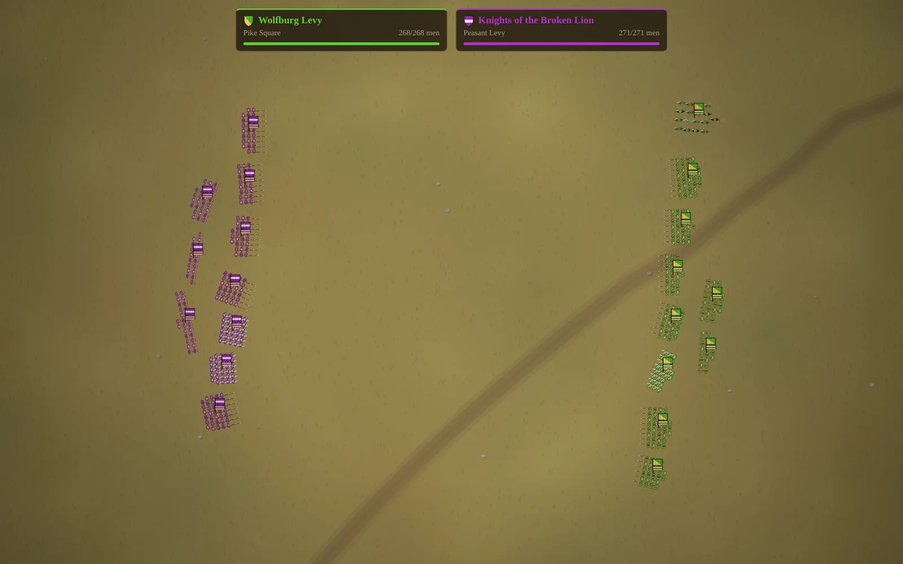
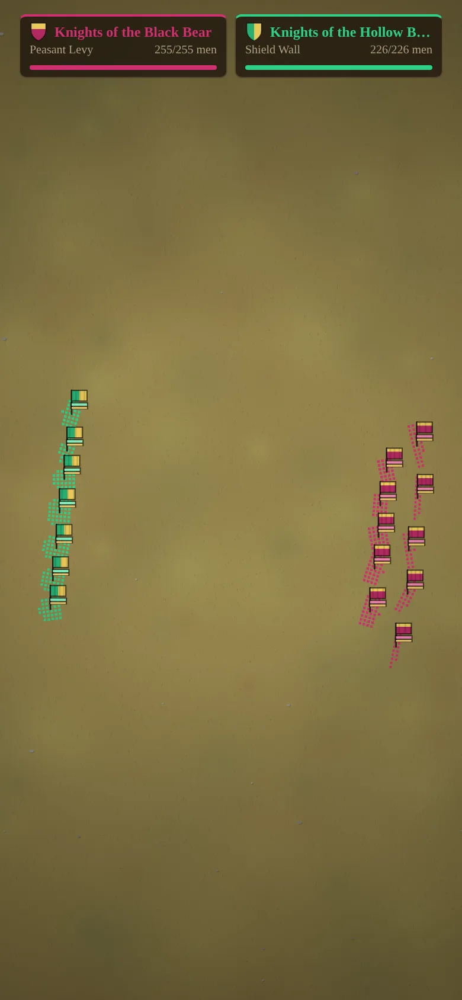

# Random Medieval Battles

[](https://github.com/ali-raheem/random-medieval-battles/actions/workflows/ci.yml) [](https://github.com/ali-raheem/random-medieval-battles/actions/workflows/pages.yml)

**▶ Try it live: [shoryuken.me/rmb](https://shoryuken.me/rmb/)** · mirror on [GitHub Pages](https://ali-raheem.github.io/random-medieval-battles/) · installable, works offline

<p align="center">
  <a href="https://shoryuken.me/rmb/"></a>
  <a href="https://shoryuken.me/rmb/"></a>
</p>

An endless, hands-off medieval battle generator. Each battle pits two (sometimes three)
procedurally generated armies of spearmen, swordsmen, archers and cavalry against each
other. When one side is dead or fled, a victory banner shows and a brand new battle
starts.

No build step, no dependencies, no network calls. Plain HTML/CSS/JS modules plus a
service worker, so it installs as a PWA and runs fully offline. It is a sibling of
Random Space Battles and shares its architecture.

## Run it

```bash
python3 -m http.server 8080   # or: npm run serve
```

Open `http://localhost:8080/`. After the first load it works with the network off.
Use the browser's "Install app" / "Add to Home Screen" for a fullscreen app.

## Controls

| Key | Action |
|---|---|
| Space | Pause / resume |
| `+` / `-` | Simulation speed (0.5× – 4×) |
| `N` | Skip to a new battle |
| `R` | Army roster: every unit type, its companies and stats |
| `L` | Recent battles: the last 5 you watched, with summary, replay and copy-link |
| `S` | Settings: install app, sound, banner bars, fullscreen, hide interface, version |
| `B` | Toggle the strength/morale bars under each banner |
| `H` | Hide the whole HUD (tap the screen to bring it back) |
| `M` | Sound on/off (remembered) |
| `F` | Fullscreen |
| `Esc` | Close the open panel |

Controls fade after a few idle seconds, and the tab holds a screen wake lock
while it's visible. So it works as a screensaver. On a touchscreen, the first tap
brings faded controls back without pressing anything.

Every battle is fully determined by its seed, which is kept in the URL
(`#seed=0000002a`). Reloading replays the current battle. Click the seed to copy
a link to it.

## What gets randomised

- **Armies**: name, commander, heraldry (field, metal and division), doctrine
  (Shield Wall, Longbow, Chivalry, Pike Square, Combined Arms, Horse Lords, Peasant
  Levy) and armour, training and discipline modifiers.
- **Unit designs**: one per unit type per army, a random variant with its own stats.
- **Companies**: size, frontage and name; deployed with infantry in the centre,
  archers ahead of or behind the line, and cavalry on the wings.
- **The field**: season and terrain (meadow, spring, autumn, heath, steppe, snow),
  a cart track and woods at the edges, and the battle's name.

| Type | Variants | Role |
|---|---|---|
| Spearmen | Spearmen, Pikemen, Halberdiers, Billmen | Long reach; brace against and wreck cavalry |
| Swordsmen | Swordsmen, Men-at-Arms, Axemen, Huscarls | Shielded, armoured; win the infantry grind against spears |
| Archers | Archers, Longbowmen, Crossbowmen | Arcing volleys; crossbows hit hard and pierce armour |
| Cavalry | Horsemen, Knights, Lancers, Light Horse | Flank, charge (huge first-strike bonus), withdraw and charge again; ride down archers |

Formations matter. Spearmen and swordsmen fight as a line while their block holds
together: they keep their places, strike only to the front, give and take blows
better than men on their own, and pikes reach past the first rank. Wheeling,
charging and hits from the side all disorder a block. A man struck from the flank
breaks ranks to fight it, and a block that loses enough cohesion dissolves into a
brawl. A spear block that is formed, standing and facing a cavalry charge stops it
dead and impales the riders. The same block caught moving, disordered or from the
side gets ridden down. Cavalry knows this, so it rides around to a block's flank or
rear before charging, and it goes after spearmen already pinned by a fight to their
front.

Shields stop arrows from the front only, and blows from behind land harder. Every
company has morale: casualties, flank attacks and friends routing nearby wear it
down, and once it breaks the company flees for its own edge of the field. A battle
that runs to 4 minutes ends at nightfall, and the army with the most fighting
strength left holds the field.

## Structure

| File | Purpose |
|---|---|
| `js/rng.js` | Seeded PRNG (mulberry32) |
| `js/gen.js` | Army, unit design, company and deployment generation. Balance tables live here |
| `js/heraldry.js` | Heraldic divisions as polygons, shared by banners and HUD shields |
| `js/sim.js` | Deterministic, DOM-free simulation: regiment AI, formations, melee, archery, morale |
| `js/audio.js` | Synthesised Web Audio effects: volleys, clashing steel, charge horns, wind, fanfare |
| `js/recent.js` | Recent-battles list: summaries, de-duplication, `localStorage` persistence |
| `js/render.js` | Canvas renderer: terrain, soldiers, arrows, banners, corpses stamped into the ground |
| `js/app.js` | Fixed-timestep loop, HUD, controls, panels, battle rotation |
| `js/version.js` | Release version and build time, shown in Settings |
| `index.html` | Page shell, including the SVG icon sprite (`#i-*` symbols) |
| `sw.js`, `manifest.webmanifest` | Offline caching + install metadata |
| `tests/sim.test.mjs` | Generation validity, determinism, battles always terminate |
| `tests/assets.test.mjs` | Every shipped file is in the service worker's cache list |

To tune pacing, change `MELEE_SCALE` / `RANGED_SCALE` in `js/gen.js` (lower means
longer battles), the morale constants in `js/sim.js`, and `TIME_LIMIT`. If you add a
file, add it to `ASSETS` in `sw.js` too.

## Releasing

```bash
npm run bump            # patch; or: npm run bump -- minor | major
```

This updates `VERSION` and the `BUILT` timestamp in `js/version.js` (and
`package.json`). The service worker is registered as `sw.js?v=<VERSION>` and names
its cache after it, so installed copies pick up a clean cache on their next visit.

## Tests

```bash
npm test
```
